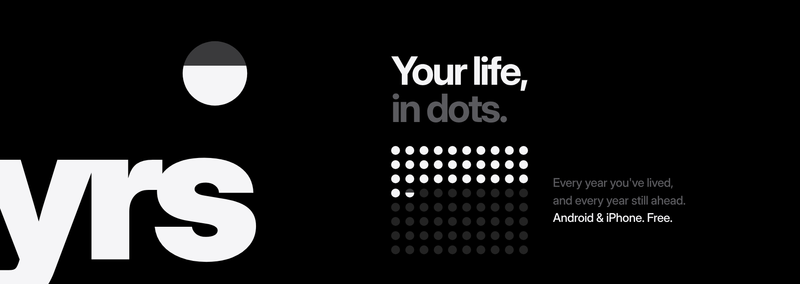
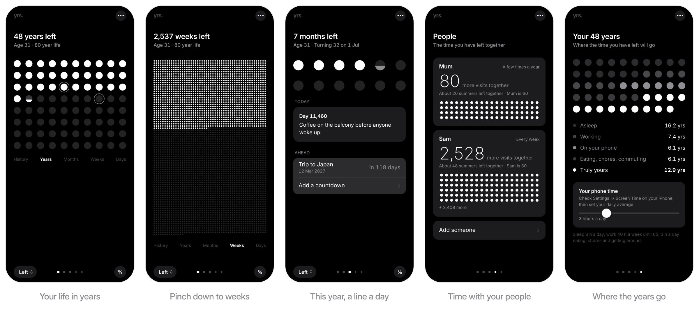
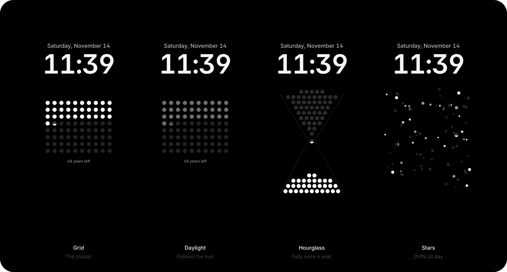
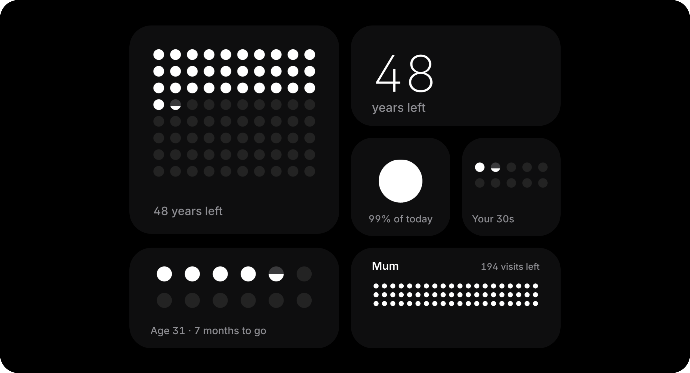

<picture>
  <source media="(prefers-color-scheme: dark)" srcset=".github/assets/banner-dark.png">
  <source media="(prefers-color-scheme: light)" srcset=".github/assets/banner-light.png">
  
</picture>

<p align="center">
  <a href="https://github.com/jrypzm/yrs/releases/latest/download/yrs.apk"><b>Download for Android</b></a>
  &nbsp;&nbsp;·&nbsp;&nbsp;
  <a href="https://jrypzm.github.io/yrs/web/"><b>Open on iPhone</b></a>
  &nbsp;&nbsp;·&nbsp;&nbsp;
  <a href="https://jrypzm.github.io/yrs/">Website</a>
</p>

<p align="center">
  <a href="https://github.com/jrypzm/yrs/releases/latest"></a>
  
  
  
</p>

<br>

**yrs.** puts your whole life on one screen. One dot for every year: white for the years behind you, dark for the years ahead, and the one you're in slowly filling. It's a quiet, honest reminder that time is finite, so you spend the rest of it on purpose.

No account. No cloud. No ads. Nothing ever leaves your phone.

<br>



<br>

## What's inside

**Your life, at every scale.** Pinch from all of human history down to a single day: History, Years, Months, Weeks, Days. The headline always counts in what you're looking at, so Weeks says weeks and Days says days.

**Count it your way.** Tap the number to count in years, days, weeks, summers, weekends or full moons. Switch between *left* and *lived*, or show a percentage. Choose Classic, Large, or Live, which ticks down to eight decimal places. Hold the number and feel the seconds as heartbeats.

**Travel through time.** Hold any dot and drag to scrub through your life. Tap a year to name it. Named years get a thin ring.

**Letters to your future self.** Seal a letter to any year ahead. It stays locked until that birthday, then opens on its own.

**A line a day.** Write one sentence about today. Years later, *on this day* brings it back. Add countdowns to what's coming.

**The people you love.** See how many more visits you'll have with your parents and friends, at the rate you see them now.

**Where your years go.** Sleep, work, upkeep and screen time, taken out of the years you have left. What remains is *truly yours*.

**Every birthday, a review.** When a year completes, yrs. shows what it held: days lived, lines written, the first and last line of the year.

<br>

## On your lock screen



On Android, yrs. sets your lock screen and redraws it every day, so it's always true. **Daylight** dims with the sun. **Hourglass** drops one grain each birthday. **Stars** drift so slowly you'll only notice tomorrow. There's also a live wallpaper that ripples through your years when you wake your phone.

<br>

## Widgets



Seven home screen widgets, one idea each: **Life**, **Number**, **Decade**, **This year**, **Days**, **Today** and **People**. Tap one to jump straight to that view.

<br>

## Get yrs.

### Android

1. Tap **[Download yrs.apk](https://github.com/jrypzm/yrs/releases/latest/download/yrs.apk)**. You always get the latest build.
2. Open it from your notifications. If Android asks, allow installs from your browser.
3. yrs. isn't on the Play Store yet, so Play Protect may ask. Tap **Install anyway**. Updates install over the top and keep your data.

Requires Android 10 or newer.

### iPhone

1. Open **[jrypzm.github.io/yrs/web](https://jrypzm.github.io/yrs/web/)** in Safari.
2. Tap **Share**, then **Add to Home Screen**.
3. Open yrs. from your Home Screen. It runs full screen and works offline.

<details>
<summary><b>Why a web app on iPhone?</b></summary>
<br>

iPhones only install native apps from the App Store, and publishing there costs $99 every year. yrs. is free, so on iPhone it lives on the web: the same design, the same maths, full screen from your Home Screen, offline, and set in the iPhone's own SF Pro.

Apple doesn't let web apps add widgets or change your wallpaper on their own, so on iPhone you save the lock screen once from Settings.
</details>

<br>

## Privacy

yrs. has nothing to send and nowhere to send it.

- **The Android app has no internet permission.** It cannot connect to anything.
- Your birthday, names, letters and lines stay on your device. Delete the app and they're gone.
- No accounts, analytics, ads or trackers. The iPhone version stores everything in Safari's storage on your phone.

<br>

## Under the hood

| | |
|---|---|
| **Android** | Kotlin, Jetpack Compose, Glance widgets, WorkManager, a live wallpaper service |
| **iPhone** | A single-file web app: vanilla JavaScript and canvas, installable, with an offline service worker |
| **Website** | WebGL: every day of a life is one point, morphing from years to weeks to days to all of history |
| **Builds** | GitHub Actions builds and signs every APK, publishes a release, and renders screenshot tests |

Age is calendar-exact, down to Feb 29 birthdays. A year holds 52.1775 weeks, and a day is a real calendar day, so every zoom level agrees with every other.

<details>
<summary><b>Project layout</b></summary>
<br>

```
android/        Native Android app (Compose UI, widgets, wallpaper, workers)
web/            The iPhone web app, icons, launch screens and service worker
index.html      The website (GitHub Pages)
marketing/      Social images
docs/           Design study
.github/        CI workflow, issue forms and README art
```
</details>

<details>
<summary><b>Building from source</b></summary>
<br>

The Android app builds with **JDK 17** and **Gradle 8.11.1**:

```sh
cd android
gradle assembleRelease
```

The APK lands in `android/app/build/outputs/apk/release/`. Screenshot tests render with `gradle :app:recordPaparazziDebug -Pshots`.

The web app and website are plain HTML. Serve the repository root with any static server and open `/` or `/web/`.
</details>

<br>

## Support

yrs. is free, made by one person, with no ads and no tracking. If it means something to you, **[give it a star](https://github.com/jrypzm/yrs)**. It's the simplest way to say thanks, and it helps other people find it.

Ideas and bug reports are welcome in **[Issues](https://github.com/jrypzm/yrs/issues/new/choose)**.

<br>

## License

Copyright © 2026 jrypzm. All rights reserved. The source is public to read, not to reuse. See [LICENSE](LICENSE).

<br>

<p align="center"><sub><b>yrs.</b> · Make the next one count.</sub></p>
