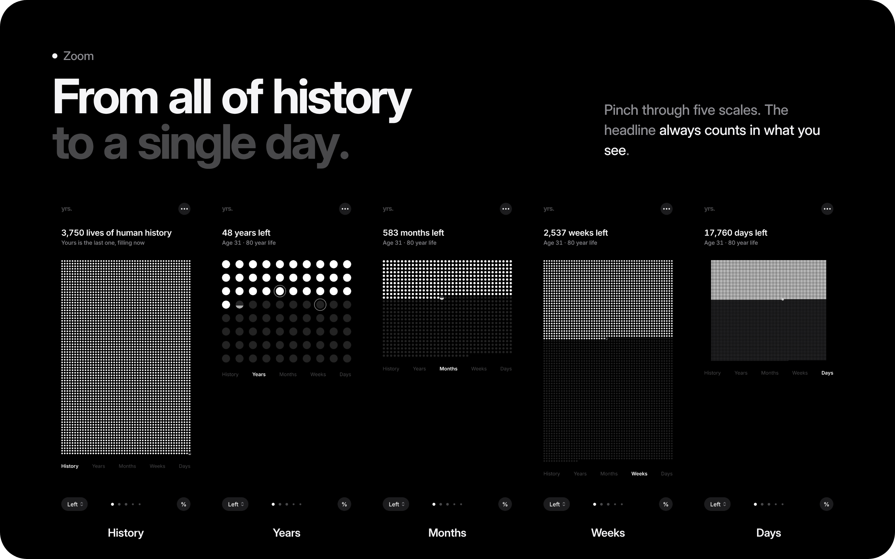
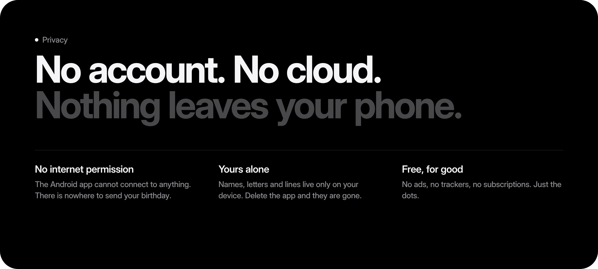

<picture>
  <source media="(prefers-color-scheme: dark)" srcset=".github/assets/hero-dark.svg">
  <source media="(prefers-color-scheme: light)" srcset=".github/assets/hero-light.svg">
  
</picture>

<br>

<p align="center">
  <a href="https://github.com/jrypzm/yrs/releases/latest/download/yrs.apk"><picture><source media="(prefers-color-scheme: dark)" srcset=".github/assets/btn-android-dark.svg"><source media="(prefers-color-scheme: light)" srcset=".github/assets/btn-android-light.svg"></picture></a>
  &nbsp;
  <a href="https://jrypzm.github.io/yrs/web/"><picture><source media="(prefers-color-scheme: dark)" srcset=".github/assets/btn-iphone-dark.svg"><source media="(prefers-color-scheme: light)" srcset=".github/assets/btn-iphone-light.svg"></picture></a>
</p>

<p align="center"><sub>Free &nbsp;·&nbsp; No account &nbsp;·&nbsp; No ads &nbsp;·&nbsp; Nothing leaves your phone &nbsp;·&nbsp; <a href="https://jrypzm.github.io/yrs/">jrypzm.github.io/yrs</a></sub></p>

<br>

<p align="center"></p>

<p align="center"></p>

<p align="center"></p>

<p align="center"></p>

<p align="center"></p>

<p align="center"></p>

<p align="center"></p>

<br>

## Get yrs.

**Android** &nbsp;·&nbsp; Android 10 or newer

1. Tap **[Download yrs.apk](https://github.com/jrypzm/yrs/releases/latest/download/yrs.apk)**. You always get the latest build.
2. Open it from your notifications. If asked, allow installs from your browser.
3. yrs. isn't on the Play Store yet, so Play Protect may ask. Tap **Install anyway**. Updates keep your data.

**iPhone** &nbsp;·&nbsp; Safari

1. Open **[jrypzm.github.io/yrs/web](https://jrypzm.github.io/yrs/web/)**.
2. Tap **Share**, then **Add to Home Screen**.
3. Open yrs. from your Home Screen. Full screen, offline, in the iPhone's own SF Pro.

<details>
<summary><b>Why a web app on iPhone?</b></summary>
<br>

iPhones only install native apps from the App Store, and publishing there costs $99 every year. yrs. is free, so on iPhone it lives on the web: the same design and the same maths, opening full screen from your Home Screen and working offline. Apple doesn't let web apps add widgets or change the wallpaper on their own, so on iPhone you save the lock screen once from Settings.
</details>

<details>
<summary><b>Under the hood</b></summary>
<br>

| | |
|---|---|
| **Android** | Kotlin, Jetpack Compose, Glance widgets, WorkManager, a live wallpaper service. No internet permission. |
| **iPhone** | One self-contained HTML file: vanilla JavaScript and canvas, installable, with an offline service worker |
| **Website** | WebGL. Every day of a life is one point, morphing from years to weeks to days to all of history |
| **Builds** | GitHub Actions builds and signs every APK, publishes the release, and renders screenshot tests |

Age is calendar-exact, down to Feb 29 birthdays. A year holds 52.1775 weeks and a day is a real calendar day, so every zoom level agrees with every other.

```
android/     Native Android app
web/         iPhone web app, icons, launch screens, service worker
index.html   Website
.github/     CI, issue forms, README art
```

Build the APK with JDK 17 and Gradle 8.11.1: `cd android && gradle assembleRelease`.
</details>

<br>

<p align="center">
  <b>If yrs. means something to you, give it a star.</b><br>
  <sub>It's free, made by one person, and a star helps other people find it.</sub><br><br>
  <a href="https://github.com/jrypzm/yrs"><picture><source media="(prefers-color-scheme: dark)" srcset=".github/assets/btn-star-dark.svg"><source media="(prefers-color-scheme: light)" srcset=".github/assets/btn-star-light.svg"></picture></a>
</p>

<p align="center"><sub><a href="https://github.com/jrypzm/yrs/issues/new/choose">Ideas & bugs</a> &nbsp;·&nbsp; <a href="SECURITY.md">Security</a> &nbsp;·&nbsp; <a href="LICENSE">License</a> &nbsp;·&nbsp; © 2026 jrypzm. All rights reserved.</sub></p>

<br>

<p align="center"><sub><b>yrs.</b> &nbsp;Make the next one count.</sub></p>
