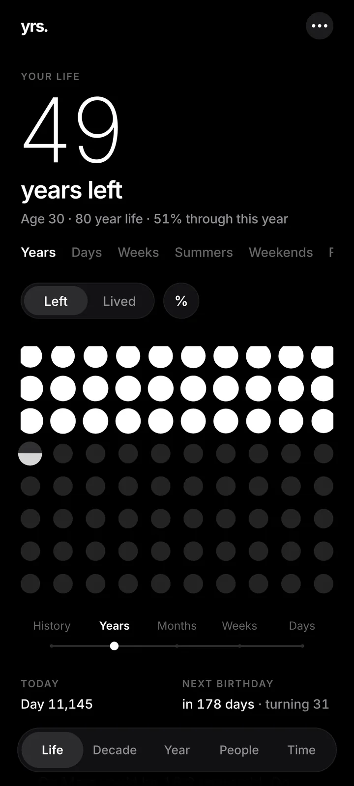
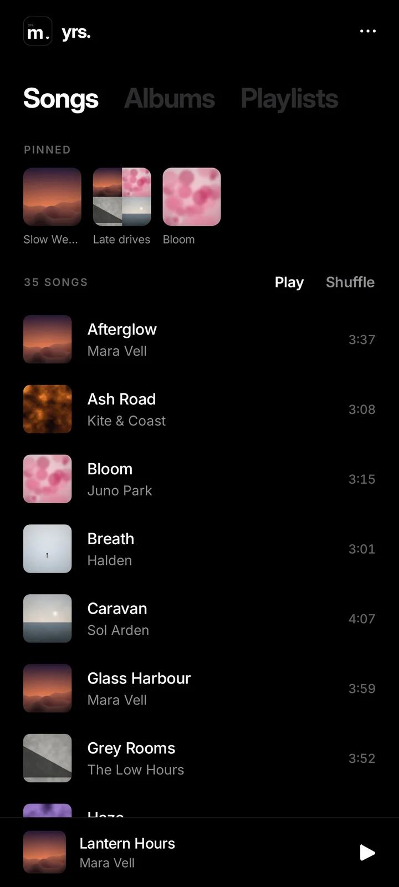
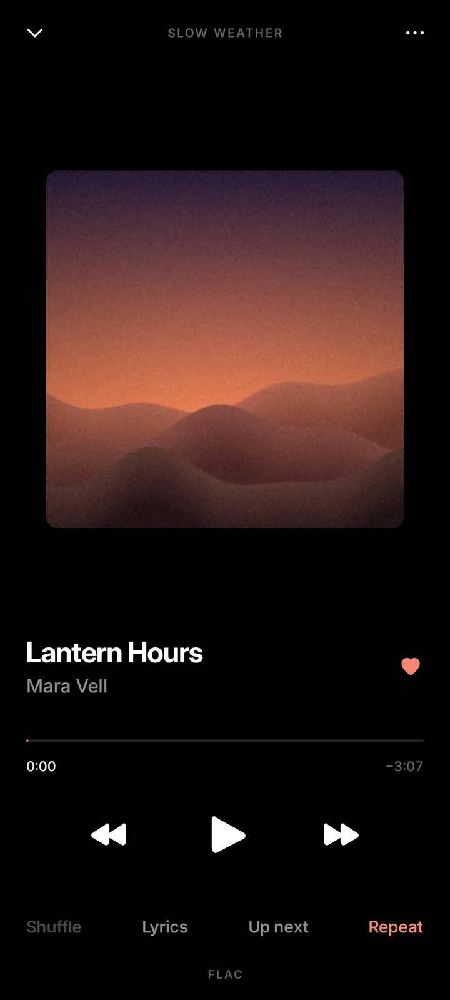

<p align="center">
  &nbsp;&nbsp;
  &nbsp;&nbsp;
  
</p>

<h1 align="center">yrs.</h1>

<p align="center"><b>Quiet apps, made by one person.</b><br>
Black and white, free and open source. No accounts, no ads, and nothing leaves your phone.</p>

<p align="center">
  <a href="https://jrypzm.github.io/yrs/"><b>Website</b></a> &nbsp;·&nbsp;
  <a href="#the-apps">The apps</a> &nbsp;·&nbsp;
  <a href="#build-it-yourself">Build</a> &nbsp;·&nbsp;
  <a href="CONTRIBUTING.md">Contribute</a>
</p>

<p align="center">
  <a href="https://github.com/jrypzm/yrs/actions/workflows/android.yml"></a>
  <a href="https://github.com/jrypzm/yrs/actions/workflows/linux.yml"></a>
  <a href="https://github.com/jrypzm/yrs/actions/workflows/home.yml"></a>
  <a href="https://github.com/jrypzm/yrs/actions/workflows/music.yml"></a>
  <a href="https://github.com/jrypzm/yrs/actions/workflows/music-linux.yml"></a>
</p>

<br>

## The apps

| | App | What it does | Get it |
|:-:|---|---|---|
|  | **[yrs.](android/)** | Your life, in dots. Every year lived and still ahead, on your screen, lock screen and widgets. | [Android](https://github.com/jrypzm/yrs/releases/latest/download/yrs.apk) · [Linux](https://github.com/jrypzm/yrs/releases/download/linux/yrs-x86_64.AppImage) · [Web](https://jrypzm.github.io/yrs/web/) |
|  | **[yrs. home](home/)** | A calm launcher. Your apps as words that glow when something new arrives; the rest waits for your hour. | [Android](https://github.com/jrypzm/yrs/releases/download/home/yrs-home.apk) |
|  | **[yrs. music](music/)** | An offline player for the songs on your phone and computer. Three words, a square cover, one colour from the artwork. | [Android](https://github.com/jrypzm/yrs/releases/download/music/yrs-music.apk) · [Linux](https://github.com/jrypzm/yrs/releases/download/music-linux/yrs-music-x86_64.AppImage) |

<p align="center">
  
  
  
  
</p>

<br>

### yrs. &nbsp;<sub>Android 10+ · Linux · any browser</sub>

Every year you've lived and every year still ahead, one dot each. Zoom from all of history down to a single day, count the visits left with the people you love, write a letter that opens on a future birthday, and put it on your lock screen so you spend the time on purpose. Four lock screens, seven widgets, and a Linux app that can set your KDE wallpaper.

**[Download for Android](https://github.com/jrypzm/yrs/releases/latest/download/yrs.apk)** · **[AppImage for Linux](https://github.com/jrypzm/yrs/releases/download/linux/yrs-x86_64.AppImage)** · **[Open in your browser](https://jrypzm.github.io/yrs/web/)** (on iPhone, add it to your Home Screen) · [More about yrs.](android/)

### yrs. home &nbsp;<sub>Android 11+ · about 200 KB</sub>

A black, quiet home screen: the time, your favourite apps as words, and everything else one swipe or one thumb away. Names glow and say who when something arrives, people reach you straight away, and shops, social and news can wait for The Hour. Search sets alarms and timers, calls, converts and counts.

**[Download for Android](https://github.com/jrypzm/yrs/releases/download/home/yrs-home.apk)**, open it and tap **Make yrs. home your home screen**. · [More about yrs. home](home/)

### yrs. music &nbsp;<sub>Android 8+ · Linux · offline</sub>

Songs, Albums and Playlists as three plain words. Tap the playing strip and the cover grows into the player on a spring; a thin line for time, three symbols, Shuffle, Lyrics, Up next and Repeat as words, and the file's format and quality at the bottom. Synced lyrics, a queue you can drag, and no internet permission at all. Made from [Lotus](https://github.com/dn0ne/lotus) by dn0ne.

**[Download for Android](https://github.com/jrypzm/yrs/releases/download/music/yrs-music.apk)** (installs next to Lotus without replacing it) · **[AppImage for Linux](https://github.com/jrypzm/yrs/releases/download/music-linux/yrs-music-x86_64.AppImage)**, songs on the left and the player on the right, a window that reshapes itself down to a mini player, gapless playback and desktop media controls · More about [Android](music/) and [Linux](music-linux/)

<br>

**On Linux Mint,** put the yrs. full stop on your panel in place of the menu's Mint logo: `curl -fsSL https://github.com/jrypzm/yrs/releases/download/mint-menu/install-yrs-menu.sh | sh` ([more](mint-menu/)).

**Files icon,** a smoked-glass folder for Nemo: `curl -fsSL https://github.com/jrypzm/yrs/releases/download/mint-files/install-yrs-files.sh | sh` ([more](mint-files/)).

**Folders,** a hundred material folders inside Nemo (denim, leather, marble, felt, puffer, wood and more), a different one for every folder: `curl -fsSL https://github.com/jrypzm/yrs/releases/download/mint-folders/install-yrs-folders.sh | sh` ([more](mint-folders/)).

**Helium,** a lime Volt icon for the Helium browser: `curl -fsSL https://github.com/jrypzm/yrs/releases/download/mint-helium/install-yrs-helium.sh | sh` ([more](mint-helium/)).

**Zim,** a grainy violet quill for Zim Desktop Wiki: `curl -fsSL https://github.com/jrypzm/yrs/releases/download/mint-zim/install-yrs-zim.sh | sh` ([more](mint-zim/)).

**Ghostty,** Ghostty's ghost as cyan light with its `>_` face: `curl -fsSL https://github.com/jrypzm/yrs/releases/download/mint-ghostty/install-yrs-ghostty.sh | sh` ([more](mint-ghostty/)).

**mpv,** a sleepy creature on candy pink with mpv's disc for a head: `curl -fsSL https://github.com/jrypzm/yrs/releases/download/mint-mpv/install-yrs-mpv.sh | sh` ([more](mint-mpv/)).

**LocalSend,** its dot as a sleepy creature inside the dashed ring, in teal: `curl -fsSL https://github.com/jrypzm/yrs/releases/download/mint-localsend/install-yrs-localsend.sh | sh` ([more](mint-localsend/)).

**Pure black,** every grey in Mint (apps, Settings, title bars, menus, the panel) in #000000: `curl -fsSL https://github.com/jrypzm/yrs/releases/download/mint-black/install-yrs-black.sh | sh` ([more](mint-black/)).

<br>

## Installing on Android

The apps aren't on the Play Store, so Android installs them straight from the download:

1. Tap the download link and open the file from your notifications.
2. If asked, allow installs from your browser.
3. Play Protect may ask about an unknown app; tap **Install anyway**. Updates install over the top and keep your data.

Every APK is built and signed by GitHub Actions from the code in this repository. The links above always point at the newest build.

<br>

## Promises

- **Nothing leaves your phone.** The Android apps have no internet permission. There is no server to send anything to.
- **No accounts, no ads, no tracking.** No sign-up, no analytics, nothing to sell.
- **Open source.** Every line is here. Read it, build it, change it.
- **Calm by design.** True black, white words, at most one colour. Nothing that shouts.

<br>

## Build it yourself

| Folder | What | Toolchain | Build |
|---|---|---|---|
| [`android/`](android/) | yrs. for Android | JDK 17, Gradle 8.11 | `gradle assembleRelease` |
| [`linux/`](linux/) | yrs. for Linux | Rust (stable) | `./build-appimage.sh` |
| [`web/`](web/) | yrs. in the browser | none | open `web/index.html` |
| [`home/`](home/) | yrs. home | JDK 17, Gradle 8.11 | `gradle assembleRelease` |
| [`music/`](music/) | yrs. music for Android | JDK 17, Gradle 8.11 | `gradle assembleRelease` |
| [`music-linux/`](music-linux/) | yrs. music for Linux | Rust (stable), ALSA headers | `./build-appimage.sh` |
| [`mint-menu/`](mint-menu/) | the yrs. menu icon for Linux Mint | Python 3 | `python3 make.py` |
| [`mint-files/`](mint-files/) | the yrs. Files icon for Nemo | Python 3 | `python3 make.py` |
| [`mint-black/`](mint-black/) | pure black Linux Mint | none (one shell script) | |
| [`mint-localsend/`](mint-localsend/) | a teal sleepy icon for LocalSend | Python 3, numpy, scipy, Pillow | `python3 make.py` |
| [`mint-mpv/`](mint-mpv/) | a pink sleepy icon for mpv | Python 3, numpy, scipy, Pillow | `python3 make.py` |
| [`mint-ghostty/`](mint-ghostty/) | a cyan ghost icon for Ghostty | Python 3, numpy, scipy, Pillow | `python3 make.py` |
| [`mint-zim/`](mint-zim/) | the Violet Quill icon for Zim | Node, Playwright, Python 3 | `python3 make.py` |
| [`mint-helium/`](mint-helium/) | the Volt icon for the Helium browser | Node, Playwright, Python 3 | `python3 make.py` |
| [`mint-folders/`](mint-folders/) | a hundred material folders for Nemo | Node, Playwright, Python 3 | `python3 make.py` |

Run each command inside its folder. The Android projects have screen tests that render every page to PNG with Robolectric or Paparazzi; see each app's README.

```
android/     yrs. for Android: Kotlin, Jetpack Compose, Glance widgets, a live wallpaper
linux/       yrs. for Linux: Rust and egui, shipped as one AppImage
web/         yrs. in the browser: one HTML file, installable, works offline
home/        yrs. home: the launcher, Kotlin and Android views
music/       yrs. music for Android: Kotlin, Compose and Media3, from Lotus (GPL-3.0)
music-linux/ yrs. music for Linux: Rust, egui and rodio
mint-menu/   the yrs. full stop as the Linux Mint menu icon
mint-files/  a smoked-glass folder icon for Nemo
mint-folders/ a hundred material folders for Nemo
mint-helium/  the Volt icon for the Helium browser
mint-zim/     the Violet Quill icon for Zim Desktop Wiki
mint-ghostty/ a cyan ghost icon for the Ghostty terminal
mint-mpv/     a pink sleepy icon for the mpv media player
mint-localsend/ a teal sleepy icon for LocalSend
mint-black/   every grey in Linux Mint in pure black
index.html   the website, with the apps and their downloads
life/        the long page about yrs.
assets/      icons and screenshots used by the website and this README
docs/        design notes
marketing/   images for posts and stories
.github/     CI that builds, signs and publishes every app; issue forms
```

### Releases

Every push that touches an app's folder builds it in GitHub Actions and replaces its release:

| App | Workflow | Release | Download |
|---|---|---|---|
| yrs. Android | [`android.yml`](.github/workflows/android.yml) | latest | [`yrs.apk`](https://github.com/jrypzm/yrs/releases/latest/download/yrs.apk) |
| yrs. Linux | [`linux.yml`](.github/workflows/linux.yml) | `linux` | [`yrs-x86_64.AppImage`](https://github.com/jrypzm/yrs/releases/download/linux/yrs-x86_64.AppImage) |
| yrs. home | [`home.yml`](.github/workflows/home.yml) | `home` | [`yrs-home.apk`](https://github.com/jrypzm/yrs/releases/download/home/yrs-home.apk) |
| yrs. music | [`music.yml`](.github/workflows/music.yml) | `music` | [`yrs-music.apk`](https://github.com/jrypzm/yrs/releases/download/music/yrs-music.apk) |
| yrs. music for Linux | [`music-linux.yml`](.github/workflows/music-linux.yml) | `music-linux` | [`yrs-music-x86_64.AppImage`](https://github.com/jrypzm/yrs/releases/download/music-linux/yrs-music-x86_64.AppImage) |

The website is served by GitHub Pages straight from the repository root.

<br>

## About

yrs. is made by one person. No company, no team, no investors: just apps I wanted to exist on my own phone, built to show what matters and then let you go.

Ideas and bug reports are welcome and every one is read: **[open an issue](https://github.com/jrypzm/yrs/issues/new/choose)**. If you'd like to help with code, start with [CONTRIBUTING.md](CONTRIBUTING.md).

<br>

## License

yrs., yrs. home, yrs. music for Linux, the website and the web app are released under the [MIT License](LICENSE).

yrs. music for Android is a modified version of [Lotus](https://github.com/dn0ne/lotus) by dn0ne and is released under the [GNU GPL v3](music/LICENSE.md), like Lotus. See [music/NOTICE](music/NOTICE).

The apps use the [Inter](https://rsms.me/inter/) typeface by Rasmus Andersson, under the SIL Open Font License 1.1.

<br>

<p align="center"><sub><b>yrs.</b> &nbsp;Make the next one count.</sub></p>
