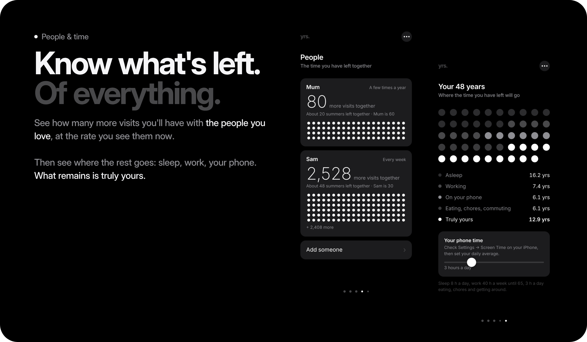
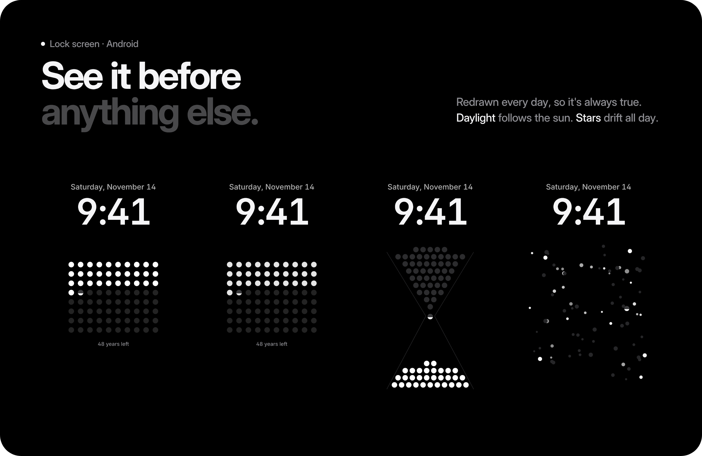

<picture>
  <source media="(prefers-color-scheme: dark)" srcset=".github/assets/hero-dark.svg">
  <source media="(prefers-color-scheme: light)" srcset=".github/assets/hero-light.svg">
  
</picture>

<br>

<p align="center">
  <a href="https://github.com/jrypzm/yrs/releases/latest/download/yrs.apk"><picture><source media="(prefers-color-scheme: dark)" srcset=".github/assets/btn-android-dark.svg"><source media="(prefers-color-scheme: light)" srcset=".github/assets/btn-android-light.svg"></picture></a>
  &nbsp;
  <a href="https://jrypzm.github.io/yrs/web/"><picture><source media="(prefers-color-scheme: dark)" srcset=".github/assets/btn-web-dark.svg"><source media="(prefers-color-scheme: light)" srcset=".github/assets/btn-web-light.svg"></picture></a>
</p>

<p align="center"><sub>Free &nbsp;·&nbsp; No account &nbsp;·&nbsp; No ads &nbsp;·&nbsp; Nothing leaves your phone &nbsp;·&nbsp; <a href="https://jrypzm.github.io/yrs/">jrypzm.github.io/yrs</a></sub></p>

<br>

<p align="center"></p>

<p align="center"></p>

<p align="center"></p>

<p align="center"></p>

<p align="center"></p>

<p align="center"></p>

<p align="center"></p>

<br>

## About

yrs. is a small, independent project made by one person. No company, no investors, no ads: just an idea I wanted to exist, built in spare time.

It's **open source under the MIT license**. Use it, read it, build it yourself, change anything, or take the code and make it your own. Pull requests and ideas are welcome.

<br>

## Get yrs.

**Android** &nbsp;·&nbsp; Android 10 or newer

1. Tap **[Download yrs.apk](https://github.com/jrypzm/yrs/releases/latest/download/yrs.apk)**. You always get the latest build.
2. Open it from your notifications. If asked, allow installs from your browser.
3. yrs. isn't on the Play Store yet, so Play Protect may ask. Tap **Install anyway**. Updates keep your data.

**Linux** &nbsp;·&nbsp; Fedora, Ubuntu, Arch and other current desktops, Wayland or X11

1. Download **[yrs-x86_64.AppImage](https://github.com/jrypzm/yrs/releases/download/linux/yrs-x86_64.AppImage)**. One file, about 5 MB.
2. Make it executable: right-click it, Properties, Permissions, **Is executable**. Or `chmod +x yrs-x86_64.AppImage`.
3. Open it. yrs. adds itself to your app launcher with its icon, so you can pin it to the taskbar. On KDE Plasma it can also set your wallpaper and lock screen, sit in the tray and start at login.

**Try it in your browser** &nbsp;·&nbsp; free, nothing to install

1. Open **[jrypzm.github.io/yrs/web](https://jrypzm.github.io/yrs/web/)** on any phone, tablet or computer.
2. Enter your birthday. That's it.
3. Like it? Add it to your **Home Screen** from your browser's Share or menu button. It opens full screen and works offline.

The browser version is the same design and the same maths. Browsers can't add widgets or change your wallpaper on their own, so there you save the lock screen once from Settings.

<details>
<summary><b>Under the hood</b></summary>
<br>

| | |
|---|---|
| **Android** | Kotlin, Jetpack Compose, Glance widgets, WorkManager, a live wallpaper service. No internet permission. |
| **Linux** | Rust and egui, drawn by hand: one 5 MB AppImage that starts instantly and idles at zero CPU. Tray, notifications and Plasma wallpaper through standard desktop services |
| **Web** | One self-contained HTML file: vanilla JavaScript and canvas, installable, with an offline service worker |
| **Website** | WebGL. Every day of a life is one point, morphing from years to weeks to days to all of history |
| **Builds** | GitHub Actions builds and signs every APK, publishes the release, and renders screenshot tests |

Age is calendar-exact, down to Feb 29 birthdays. A year holds 52.1775 weeks and a day is a real calendar day, so every zoom level agrees with every other.

```
android/     Native Android app
linux/       Linux desktop app (Rust)
web/         Browser version, icons, launch screens, service worker
index.html   Website
.github/     CI, issue forms, README art
```

Build the APK with JDK 17 and Gradle 8.11.1: `cd android && gradle assembleRelease`.
</details>

<br>

<p align="center">
  <b>If yrs. means something to you, give it a star.</b><br>
  <sub>It's free, made by one person, and a star helps other people find it.</sub><br><br>
  <a href="https://github.com/jrypzm/yrs"><picture><source media="(prefers-color-scheme: dark)" srcset=".github/assets/btn-star-dark.svg"><source media="(prefers-color-scheme: light)" srcset=".github/assets/btn-star-light.svg"></picture></a>
</p>

<p align="center"><sub><a href="https://github.com/jrypzm/yrs/issues/new/choose">Ideas & bugs</a> &nbsp;·&nbsp; <a href="CONTRIBUTING.md">Contributing</a> &nbsp;·&nbsp; <a href="SECURITY.md">Security</a> &nbsp;·&nbsp; <a href="LICENSE">MIT License</a></sub></p>

<br>

<p align="center"><sub><b>yrs.</b> &nbsp;Make the next one count.</sub></p>
