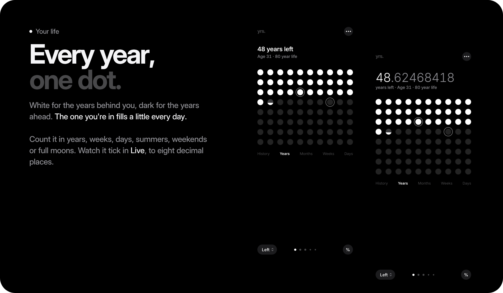
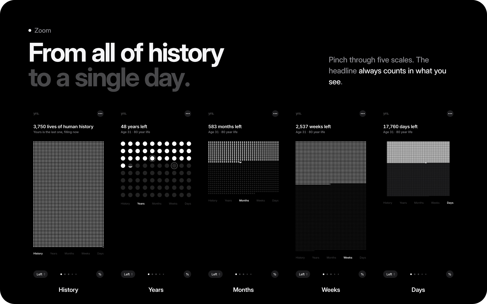
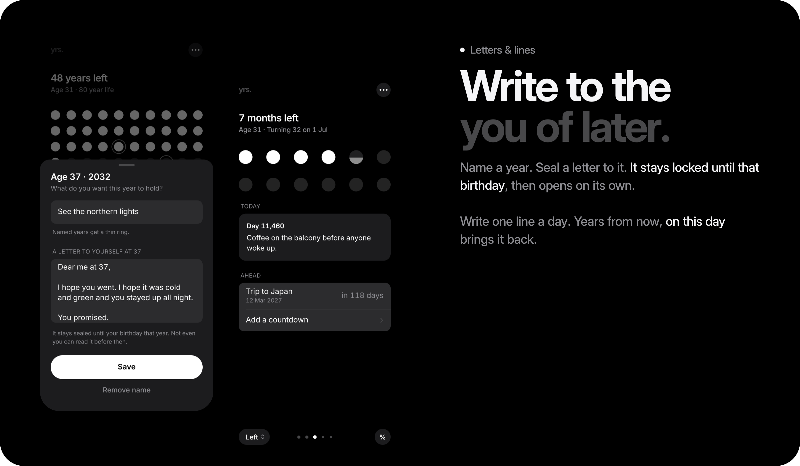
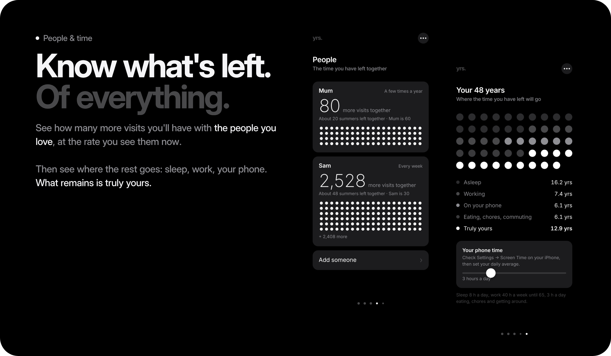
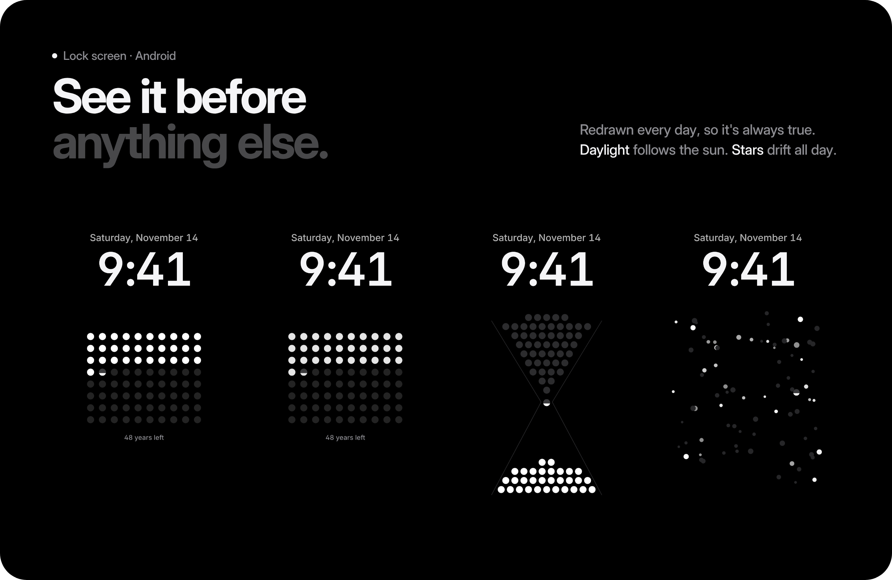
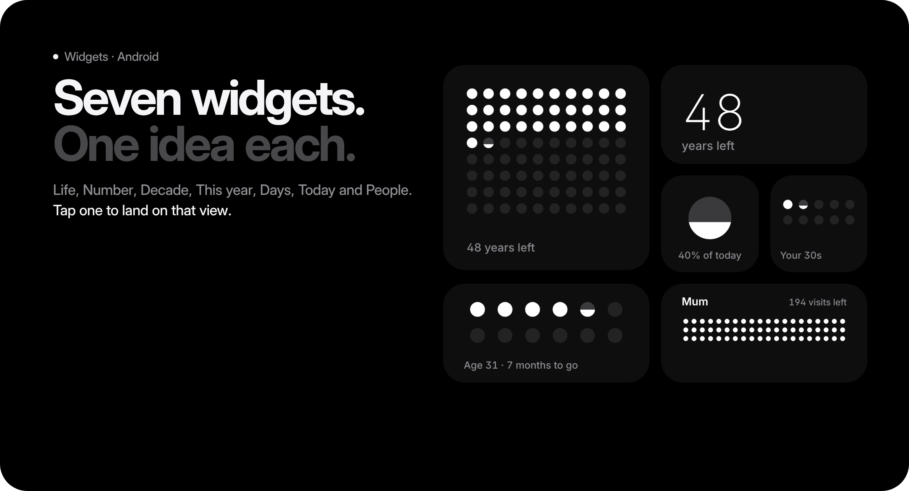
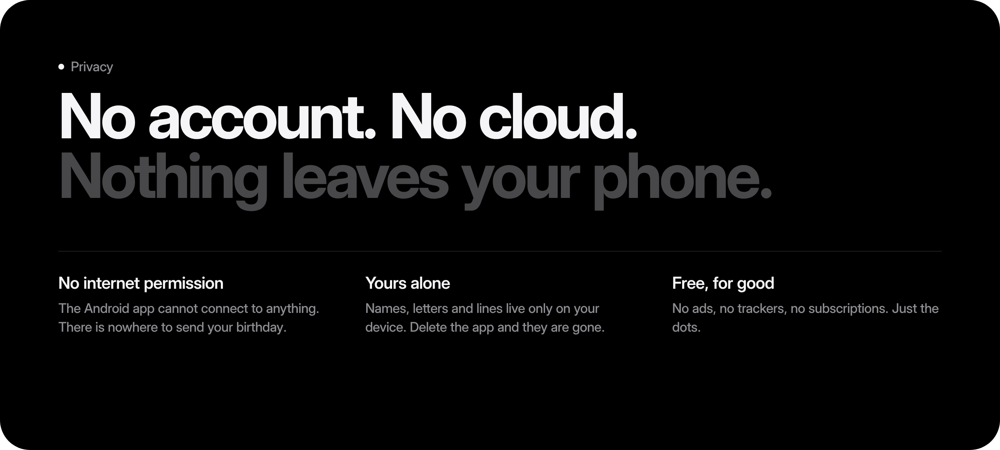

<picture>
  <source media="(prefers-color-scheme: dark)" srcset="../.github/assets/hero-dark.svg">
  <source media="(prefers-color-scheme: light)" srcset="../.github/assets/hero-light.svg">
  
</picture>

# yrs. for Android

Every year you've lived and every year still ahead, one dot each. Android 10 or newer, no internet permission.

**[Download yrs.apk](https://github.com/jrypzm/yrs/releases/latest/download/yrs.apk)** · also on [Linux](../linux/) and [in your browser](https://jrypzm.github.io/yrs/web/)

<p align="center"></p>
<p align="center"></p>
<p align="center"></p>
<p align="center"></p>
<p align="center"></p>
<p align="center"></p>
<p align="center"></p>

## How it counts

Age is calendar-exact, down to 29 February birthdays. A year holds 52.1775 weeks and a day is a real calendar day, so every zoom level agrees with every other. A heading always counts in the unit it shows.

## Inside

Kotlin and Jetpack Compose, Glance for the widgets, WorkManager to redraw the lock screen each day, and a live wallpaper service. Everything is stored on the phone.

```
app/src/main/java/app/years/
  MainActivity.kt         entry point
  Home.kt, Life.kt, Grid.kt   the main screen and the dots
  Pages.kt, Sheets.kt     Decade, Year, People, Time and their sheets
  Widgets.kt              the seven Glance widgets
  Render.kt, Work.kt      lock screen images and the daily redraw
  YearsWallpaperService.kt   the live wallpaper
  Onboarding.kt, Tour.kt  first open
```

## Build

JDK 17 and Gradle 8.11:

```
cd android
gradle assembleRelease                          # app/build/outputs/apk/release/
gradle :app:recordPaparazziDebug -Pshots        # render every screen with Paparazzi
```

CI ([`android.yml`](../.github/workflows/android.yml)) builds and signs the APK, publishes it as the latest release, and attaches the rendered screens.
