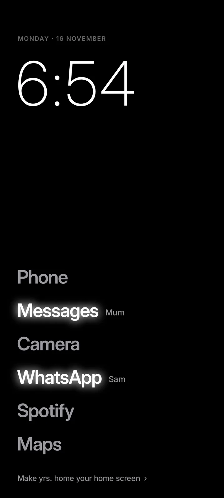
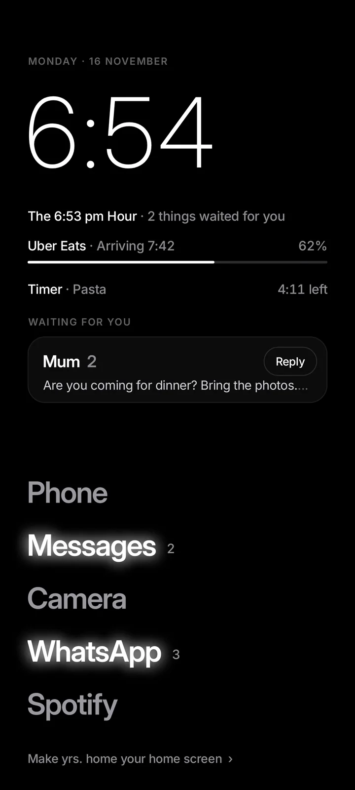

<p align="center"></p>

<h1 align="center">yrs. home</h1>

<p align="center">A black, quiet home screen for Android 11 or newer.<br>About 200 KB, no internet permission.</p>

<p align="center"><b><a href="https://github.com/jrypzm/yrs/releases/download/home/yrs-home.apk">Download yrs-home.apk</a></b></p>

<p align="center">
  
  
</p>

Open it and tap **Make yrs. home your home screen**. Swipe up for all apps and search, slide your thumb down the right edge to open any app by letter, hold an app for more, double-tap to lock. Your previous launcher stays one tap away in Settings.

## What it does

All of it on the phone:

- **Words that glow.** No dots: an app's name lights up when something new arrives, and says who.
- **People waiting.** Messages from people across WhatsApp, SMS, Telegram and others, with reply right there.
- **The Hour.** Optional. People reach you straight away; shops, social and news wait for the times you pick and arrive together.
- **The live line.** Timers, calls, deliveries and directions under the clock, with music controls and a timeline when something plays.
- **Search that understands.** `7:30` sets an alarm, `10 min` a timer, a number calls, `.yt lofi` searches inside YouTube, `days to christmas` counts, `12 × 8.5` calculates, `5 km` converts.
- **Moments.** A different home for morning, work, evening and night. Headphones in brings your music app forward.
- **A pause that grows.** Chosen apps wait a few seconds more each time you open them today, and ask why.
- **And** away time, new and quiet apps, a torch that's a word, a thumb rail you can feel, Work and Private Space as their own sections, and a layout that always fits, however many apps and however small the window.

## Inside

Kotlin and plain Android views, no Compose, so it's tiny and fast to start.

```
app/src/main/java/app/years/home/
  HomeActivity.kt   the home screen, the drawer and the layout that fits
  Apps.kt           every launchable app, across profiles
  Search.kt, Smart.kt   search and what it understands
  Media.kt          the music card and its timeline
  Services.kt       notifications for glowing names and The Hour
  Pages.kt          the pause, settings and app picker screens
  Parts.kt          pieces of the home: the fitting column, people, the live line
  Extras.kt         the torch, the haptics, away time
  Prefs.kt          everything saved, on the phone
```

## Build and test

JDK 17 and Gradle 8.11:

```
cd home
gradle assembleRelease      # app/build/outputs/apk/release/
gradle testDebugUnitTest    # 43 tests; screens render into app/build/screens
```

The tests run with Robolectric: the logic behind search and moments, every feature, real renders of every screen, and a layout audit across six screen sizes. CI ([`home.yml`](../.github/workflows/home.yml)) runs them, builds the signed APK and publishes it to the `home` release.
