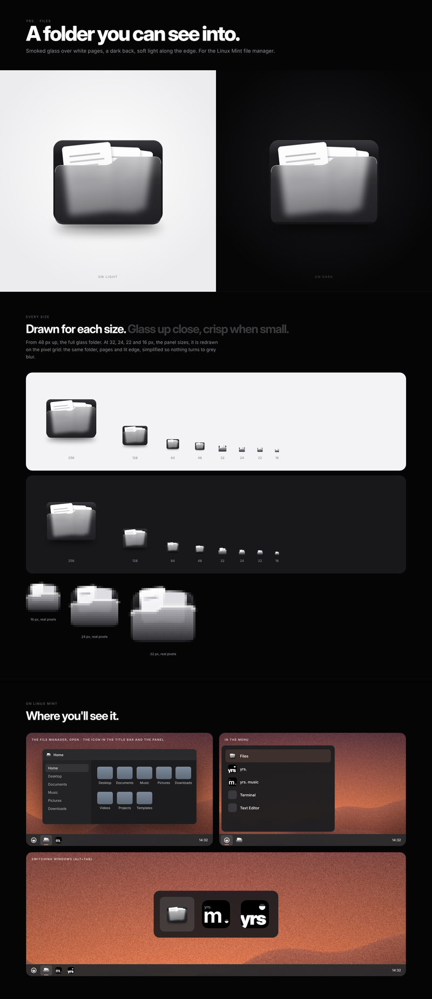

# yrs. Files for Linux Mint

A new icon for Nemo, the Linux Mint file manager: a smoked-glass folder with white pages inside.



## Install

```
curl -fsSL https://github.com/jrypzm/yrs/releases/download/mint-files/install-yrs-files.sh | sh
```

If the old icon still shows, press <kbd>Ctrl</kbd>+<kbd>Alt</kbd>+<kbd>Esc</kbd> to refresh Cinnamon, or log out and in.

## Undo

```
curl -fsSL https://github.com/jrypzm/yrs/releases/download/mint-files/install-yrs-files.sh | sh -s -- --undo
```

## What it does

- Puts the icon, drawn at ten sizes from 16 to 512 pixels, in `~/.local/share/icons/hicolor`.
- Copies Nemo's launcher to `~/.local/share/applications/nemo.desktop` with `Icon=yrs-files`. The system file is never touched, so Nemo updates keep working.
- If you already had your own Nemo launcher there, it is saved first and put back on undo.
- Needs no root and nothing from the internet beyond the script itself.

It changes the app icon of the file manager (menu, panel, Alt+Tab). The folder icons inside Nemo come from your icon theme.

## Build

```
python3 make.py
```

The big sizes come from `source/folder.html`, rendered at 1024 pixels in Chromium (real backdrop blur for the glass) and scaled down. The 16 to 32 pixel sizes are drawn separately on the pixel grid by `source/small.py`, so they stay sharp. `make.py` packs every PNG into `install-yrs-files.sh`.
