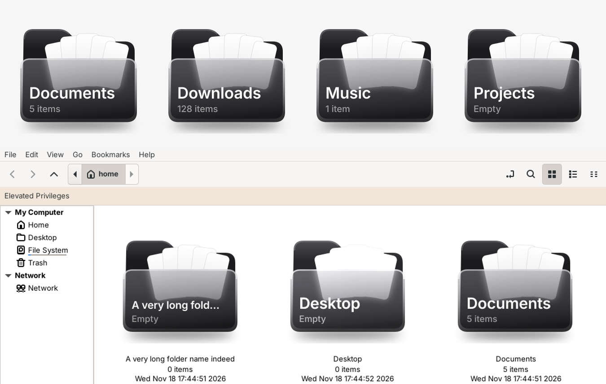

# yrs. folders for Linux Mint

Black glass folders in Nemo, the Linux Mint file manager. Every folder gets its own name written on the frosted front, and how many things are inside, which updates as you add and remove files.



## Install

```
curl -fsSL https://github.com/jrypzm/yrs/releases/download/mint-folders/install-yrs-folders.sh | sh
```

Then open Files and make the icons bigger with <kbd>Ctrl</kbd>+<kbd>+</kbd> (or the slider at the bottom right) so the names are easy to read.

If it says Nemo's Python support is missing, run `sudo apt install nemo-python` and try again.

## Undo

```
curl -fsSL https://github.com/jrypzm/yrs/releases/download/mint-folders/install-yrs-folders.sh | sh -s -- --undo
```

## How it works

A small Nemo plugin, [`yrs-folders.py`](yrs-folders.py), installed for you only in `~/.local/share/nemo-python/extensions`. For each folder Nemo shows, it draws an SVG with that folder's name and sets it as the folder's custom icon (the same thing as Properties → choose an icon). The pictures live in `~/.cache/yrs-folders`.

- A folder you already gave your own icon is left alone.
- Undo removes the plugin and clears only the icons it set.
- No root, no internet, nothing runs outside Nemo.

The name shows in Nemo's icon view, and on the desktop. Dialogs from other apps and the sidebar keep your theme's icons.

## Build

```
python3 make.py
```

packs `yrs-folders.py` into `install-yrs-folders.sh`.
