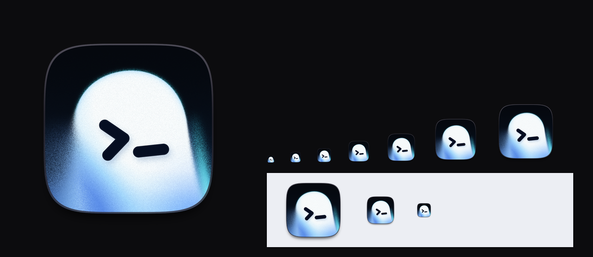

# A Ghostty icon for Linux Mint

A new icon for the [Ghostty](https://ghostty.org) terminal: Ghostty's ghost made of cyan light, its `>_` prompt for a face, crisp along the top and melting into blue and violet below, the glow breaking into grain as it spreads.



## Install

```
curl -fsSL https://github.com/jrypzm/yrs/releases/download/mint-ghostty/install-yrs-ghostty.sh | sh
```

If you still see the old icon, press <kbd>Ctrl</kbd>+<kbd>Alt</kbd>+<kbd>Esc</kbd> to refresh Cinnamon, or log out and in.

## Undo

```
curl -fsSL https://github.com/jrypzm/yrs/releases/download/mint-ghostty/install-yrs-ghostty.sh | sh -s -- --undo
```

## What it does

- Puts the icon in `~/.local/share/icons/hicolor` as `yrs-ghostty`, at ten sizes from 16 to 512 pixels: a name of its own, so no icon theme can override it.
- Gives Ghostty's launcher a personal copy in `~/.local/share/applications`, identical except for the icon. That covers `com.mitchellh.ghostty.desktop` (apt, Flatpak or built from source) and the Snap's `ghostty_ghostty.desktop`. Yours is used before theirs.
- If a launcher of your own starts Ghostty with another icon, it is pointed at the new one too.
- Anything it replaces is copied to `~/.local/share/yrs-ghostty` first, and undo puts it back.
- No root, nothing downloaded, Ghostty itself is not changed.

Ghostty and its ghost belong to the Ghostty project; this is an unofficial fan icon.

## Build

```
python3 make.py
```

paints the icon with [`source/paint.py`](source/paint.py) (numpy, scipy and Pillow): every pixel's colour comes from where it sits relative to the ghost's edge, and the grain is dithered into the light as it thins. It is scaled to every size in `icons/` and packed into `install-yrs-ghostty.sh`. `python3 make.py --pack` packs `icons/` as it is.
