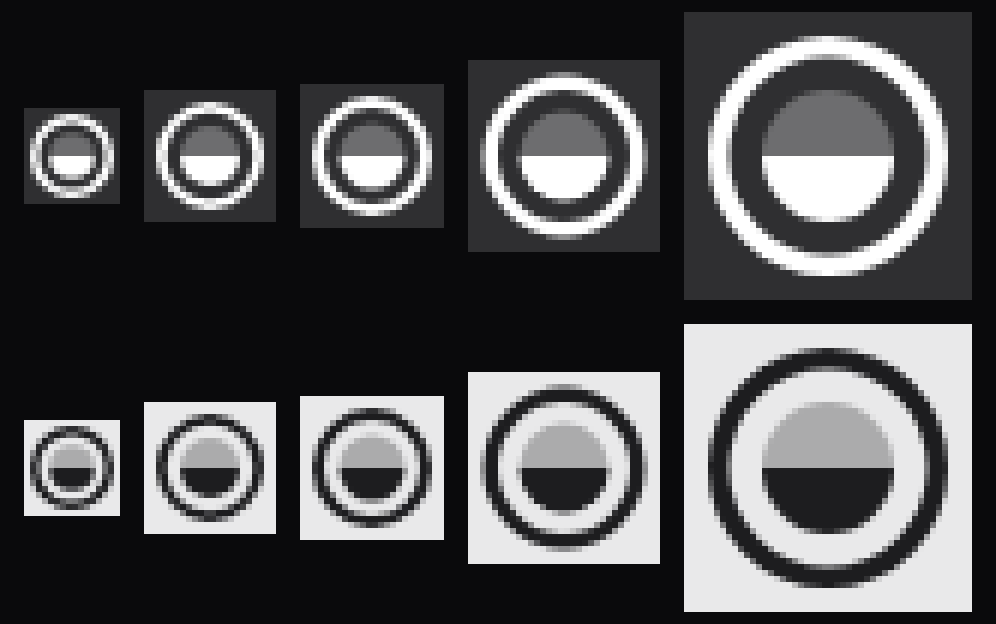

# The yrs. menu icon for Linux Mint

The yrs. full stop on your Cinnamon panel, in place of the menu's Mint logo: a ring, and inside it a circle that is half lit, like a life under way.

<p align="center"></p>

## Install

Open a terminal and paste:

```
curl -fsSL https://github.com/jrypzm/yrs/releases/download/mint-menu/install-yrs-menu.sh | sh
```

Or download [install-yrs-menu.sh](https://github.com/jrypzm/yrs/releases/download/mint-menu/install-yrs-menu.sh) and run `sh install-yrs-menu.sh`.

If the old icon is still showing, press **Ctrl+Alt+Esc** to refresh Cinnamon.

## Undo

```
curl -fsSL https://github.com/jrypzm/yrs/releases/download/mint-menu/install-yrs-menu.sh | sh -s -- --undo
```

This puts back exactly the icon you had before.

## What it does

Everything happens inside your home folder. No root, and nothing is downloaded beyond the script itself:

- copies the icon into `~/.local/share/icons/hicolor`, at 16, 22, 24, 32 and 48 pixels and scalable;
- remembers your current menu icon, then sets Cinnamon's menu icon (`org.cinnamon app-menu-icon-name`) to `yrs-menu-symbolic`;
- if one of your menus uses its own custom icon, points that one at it too, after keeping a copy of its settings.

## How it's made

Each size is drawn on its own pixel grid rather than scaled: flat edges sit on whole pixels, and the ring is thinner at small sizes so every size looks equally bold. The icon is *symbolic*: one colour, made only of filled shapes, so Cinnamon recolours it to match your panel theme, light or dark.

`make.py` draws the icons and builds `install-yrs-menu.sh` with them inside; CI publishes it to the [`mint-menu` release](https://github.com/jrypzm/yrs/releases/tag/mint-menu).
