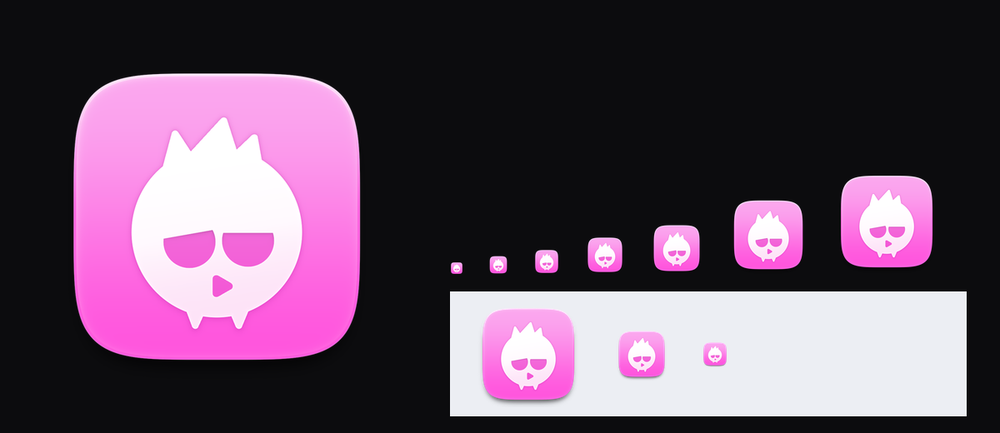

# An mpv icon for Linux Mint

A new icon for the [mpv](https://mpv.io) media player: a sleepy milky creature on a candy-pink tile, its head mpv's disc, its half-lidded eyes cut right through, a tiny play shape for a mouth, a spiky tuft and two little fangs.



## Install

```
curl -fsSL https://github.com/jrypzm/yrs/releases/download/mint-mpv/install-yrs-mpv.sh | sh
```

If you still see the old icon, press <kbd>Ctrl</kbd>+<kbd>Alt</kbd>+<kbd>Esc</kbd> to refresh Cinnamon, or log out and in.

## Undo

```
curl -fsSL https://github.com/jrypzm/yrs/releases/download/mint-mpv/install-yrs-mpv.sh | sh -s -- --undo
```

## What it does

- Puts the icon in `~/.local/share/icons/hicolor` as `yrs-mpv`, at ten sizes from 16 to 512 pixels: a name of its own, so no icon theme can override it.
- Gives mpv's launcher a personal copy in `~/.local/share/applications`, identical except for the icon. That covers `mpv.desktop` (apt), `io.mpv.Mpv.desktop` (Flatpak) and the Snap's `mpv_mpv.desktop`. Mint's icon theme has its own mpv icon, which is why the new one has a name of its own. Yours is used before theirs.
- If a launcher of your own starts mpv with another icon, it is pointed at the new one too.
- Anything it replaces is copied to `~/.local/share/yrs-mpv` first, and undo puts it back.
- No root, nothing downloaded, mpv itself is not changed.

mpv and its logo belong to the mpv project; this is an unofficial fan icon.

## Build

```
python3 make.py
```

paints the icon with [`source/sleepy.py`](source/sleepy.py) (numpy, scipy and Pillow), every shape drawn as a signed distance so its edges stay crisp at any size. It is scaled to every size in `icons/` and packed into `install-yrs-mpv.sh`. `python3 make.py --pack` packs `icons/` as it is.
