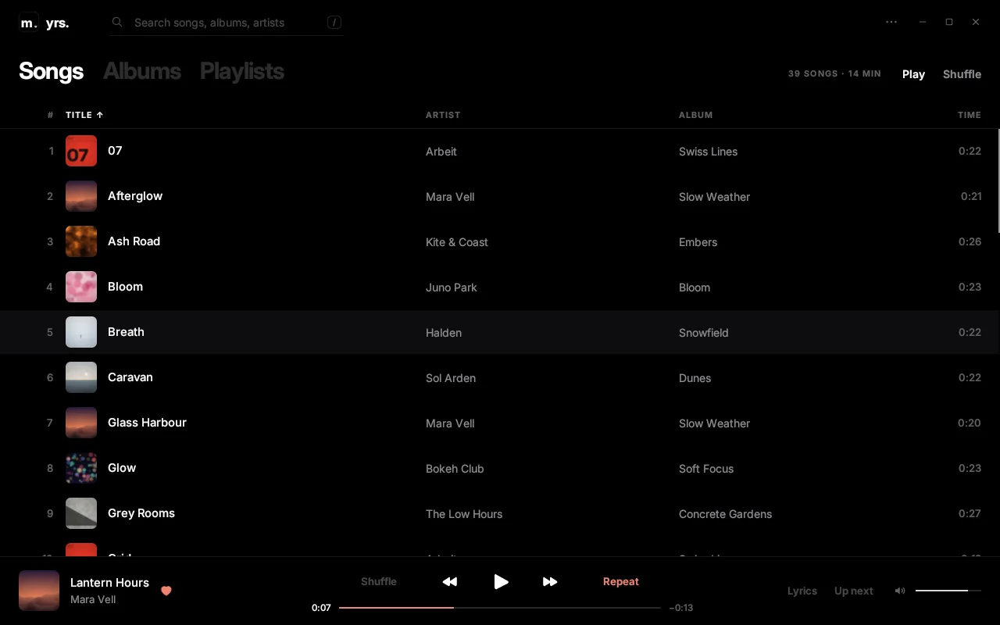

<p align="center"></p>

<h1 align="center">yrs. music for Linux</h1>

<p align="center">Your music, offline. One AppImage for Fedora, Ubuntu, Arch and other current desktops.</p>

<p align="center"><b><a href="https://github.com/jrypzm/yrs/releases/download/music-linux/yrs-music-x86_64.AppImage">Download yrs-music-x86_64.AppImage</a></b></p>

<p align="center"></p>
<p align="center"></p>

1. Make it executable: right-click it, Properties, Permissions, **Is executable**. Or `chmod +x yrs-music-x86_64.AppImage`.
2. Open it, and drop a folder of music on the window (or choose one, or use your Music folder).

## What it does

- **Songs, Albums, Playlists.** Three words at the top. Songs is a table you can sort; Albums is a grid of covers; Loved and your playlists live in Playlists.
- **The player.** Click the playing bar and the cover grows into the player, with one colour borrowed from the artwork. Synced lyrics beside it, or what plays next.
- **Gapless.** The next song is queued a few seconds early, so albums play without a gap.
- **Honest quality.** FLAC, MP3, AAC and ALAC, Ogg Vorbis, WAV and AIFF, with the format, bit depth and sample rate shown as they are.
- **Your desktop's controls.** Media keys, the GNOME and KDE panels and the lock screen control it through MPRIS.
- **Mini player.** Press M for a small window that stays on top.
- **Lyrics** from a `.lrc` file beside the song, from the song's own tag, or from a file you choose.
- **It remembers** your queue and where you were, and reopens paused right there.

Nothing leaves your computer. Your files are read where they are; the app keeps its library cache in `~/.local/share/yrs-music` and covers in `~/.cache/yrs-music`.

## Keys

| Key | Does |
|---|---|
| Space | Play or pause |
| ← → | Back or ahead five seconds |
| Ctrl ← → | Previous or next song |
| ↑ ↓ | Volume |
| / or Ctrl F | Search |
| L | Lyrics |
| M | Mini player |
| Esc | Close or go back |

## Inside

Rust and [egui](https://github.com/emilk/egui), drawn by hand in the yrs. look. [rodio](https://github.com/RustAudio/rodio) and Symphonia for sound, [lofty](https://github.com/Serial-ATA/lofty-rs) for tags and covers, [souvlaki](https://github.com/Sinono3/souvlaki) for the desktop controls.

```
src/
  main.rs      the window
  app.rs       state, keys, the desktop
  pages.rs     Songs, Albums, Playlists, an album, a playlist, search, settings, first open
  now.rs       the playing bar, the player, lyrics, up next, the mini player
  player.rs    the queue: shuffle, repeat, play next, gapless hand-over
  audio.rs     the sound thread
  library.rs   reading folders, tags and covers
  covers.rs    covers as textures, and the colour of each
  lyrics.rs    .lrc and tag lyrics
  mpris.rs     media keys and desktop controls
```

## Build

Rust stable and the ALSA headers (`libasound2-dev` on Debian and Ubuntu, `alsa-lib-devel` on Fedora):

```
cd music-linux
cargo run --release        # run it
cargo test                 # the lyrics parser
./build-appimage.sh        # dist/yrs-music-x86_64.AppImage
```

CI ([`music-linux.yml`](../.github/workflows/music-linux.yml)) tests it, builds the AppImage and publishes it to the `music-linux` release.

yrs. music for Linux is new code, released under the MIT License like the rest of yrs. (the Android yrs. music is GPL-3.0, made from Lotus).
