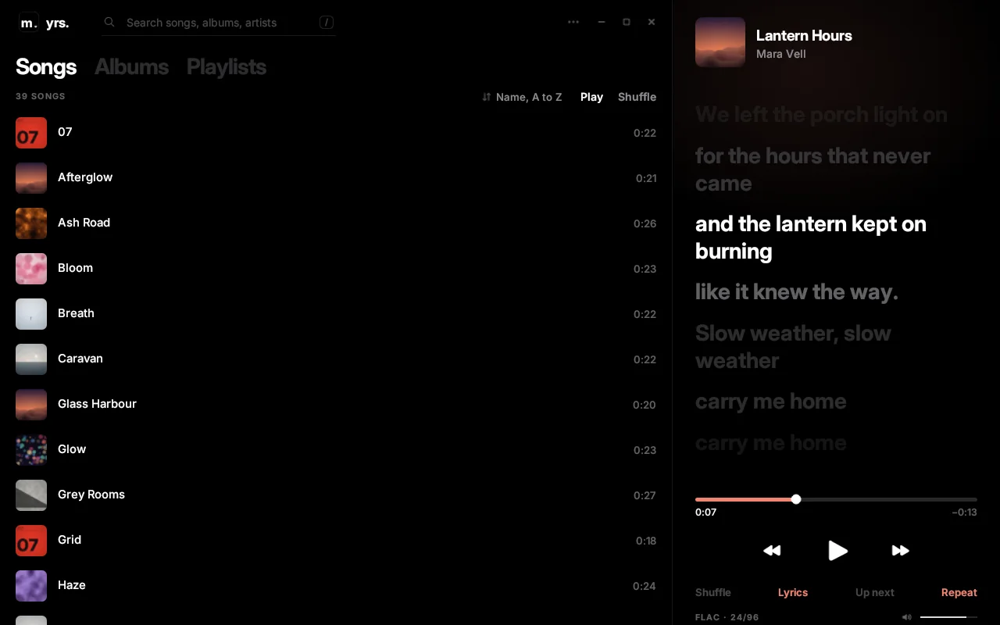

<p align="center"></p>

<h1 align="center">yrs. music for Linux</h1>

<p align="center">Your music, offline. One AppImage for Fedora, Ubuntu, Arch and other current desktops.</p>

<p align="center"><b><a href="https://github.com/jrypzm/yrs/releases/download/music-linux/yrs-music-x86_64.AppImage">Download yrs-music-x86_64.AppImage</a></b></p>

<p align="center"></p>
<p align="center"></p>

1. Make it executable: right-click it, Properties, Permissions, **Is executable**. Or `chmod +x yrs-music-x86_64.AppImage`.
2. Open it, and drop a folder of music on the window (or choose one, or use your Music folder).

## What it does

- **Songs on the left, the player on the right.** The list shows each song's name; one click plays it. The player keeps the big cover in view with the time, the three symbols and Shuffle, Lyrics, Up next and Repeat. Drag the line between them to give either side more room, or put the player along the bottom from the three dots.
- **Sort the way you think:** by name, file size, length or the date a file changed, each either way round.
- **One window, every size.** There is no separate mini player: make the window smaller and it reshapes itself. Narrow, it becomes a list with a strip below like the phone; small, a mini player; flat and wide, a thin strip for the edge of the screen; tiny, just the cover with the symbols over it.
- **Lyrics and Up next** open inside the player: synced lyrics glide to the current line (click one to jump there), the queue drags to reorder.
- **Gapless.** The next song is queued a few seconds early, so albums play without a gap.
- **Honest quality.** FLAC, MP3, AAC and ALAC, Ogg Vorbis, WAV and AIFF, with the format, bit depth and sample rate shown as they are.
- **Your desktop's controls.** Media keys, the Cinnamon, GNOME and KDE sound applets and the lock screen control it through MPRIS.
- **It remembers** your queue, where you were, the window size and the layout, and reopens paused right there.

Nothing leaves your computer. Your files are read where they are; the app keeps its library cache in `~/.local/share/yrs-music` and covers in `~/.cache/yrs-music`.

**Window frame.** yrs. music draws its own black frame; grab any edge or corner to resize it. If your desktop prefers its own frame (title bar and borders), turn on Settings → Use the desktop's window frame.

## Keys

| Key | Does |
|---|---|
| Space | Play or pause |
| ← → | Back or ahead five seconds |
| Ctrl ← → | Previous or next song |
| ↑ ↓ | Volume |
| / or Ctrl F | Search |
| L | Lyrics |
| Esc | Close or go back |

## Inside

Rust and [egui](https://github.com/emilk/egui), drawn by hand in the yrs. look. [rodio](https://github.com/RustAudio/rodio) and Symphonia for sound, [lofty](https://github.com/Serial-ATA/lofty-rs) for tags and covers, [souvlaki](https://github.com/Sinono3/souvlaki) for the desktop controls.

```
src/
  main.rs      the window
  app.rs       state, keys, the desktop
  layout.rs    the window's shape: wide, narrow, mini, strip, tiny; the player panel
  pages.rs     Songs, Albums, Playlists, an album, a playlist, search, settings, first open
  now.rs       the playing bar, the full player, lyrics, up next
  player.rs    the queue: shuffle, repeat, play next, gapless hand-over
  audio.rs     the sound thread
  library.rs   reading folders, tags and covers
  covers.rs    covers as textures, and the colour of each
  lyrics.rs    .lrc and tag lyrics
  mpris.rs     media keys and desktop controls
```

## Build

Rust stable and the ALSA headers (`libasound2-dev` on Debian and Ubuntu, `alsa-lib-devel` on Fedora):

```
cd music-linux
cargo run --release        # run it
cargo test                 # lyrics, layout shapes, dates and sizes
./build-appimage.sh        # dist/yrs-music-x86_64.AppImage
```

CI ([`music-linux.yml`](../.github/workflows/music-linux.yml)) tests it, builds the AppImage and publishes it to the `music-linux` release.

yrs. music for Linux is new code, released under the MIT License like the rest of yrs. (the Android yrs. music is GPL-3.0, made from Lotus).
